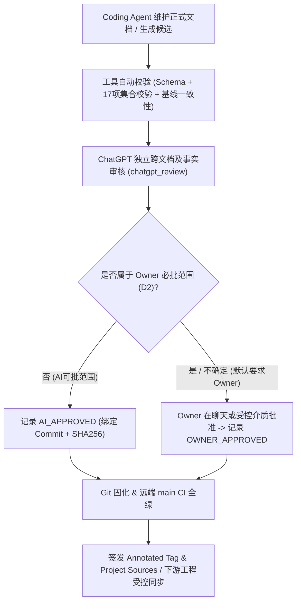

# 系统架构设计 (System Architecture)

## 1. 核心架构组件与边界

- **规范定义层 (`standards/` + `templates/`)**：承载人类可读与智能体可读的权威条文及 12 类标准文档模板，是所有下游工程架构与研发契约的上游源头。
- **契约模式层 (`schemas/` + `governance/`)**：以 `schemas/*.schema.json` 为唯一权威机器契约，`governance/engineering-manifest-schema.json` 作为受控只读兼容镜像，消除双轨 Schema 漂移。
- **自动化治理工具层 (`tools/`)**：
  - `tools/standards_sync/`：负责远端/本地正式 Tag 发现、四元组校验、版本/条款/Schema 差异对比、10 维度兼容性影响评估、升级候选生成、回归验证、受控晋升与历史回滚。
  - `tools/generate_engineering_baseline.py`：负责汇聚 10 类正式文档与 9 类实时事实，确定性产出 `docs/当前权威基线.md`。
  - `tools/generate_handoff.py`：负责自动采集 Git/CI/测试/决策状态并生成 `docs/CROSS-SESSION-HANDOFF.md` 及 `handoff/` 快照。
  - `tools/validate-documentation-collection.py` & `tools/validate_approval_contract.py`：负责 17 项文档集合校验与双层审批真实性门禁。
- **只读下游消费边界**：`AI-Engineering-Hub`、`AI-KB`、`vtip-platform-catalog`、`vtip-ai-sidecar` 单向依赖本仓库发布的已验证 Tag，本仓库严禁反向依赖下游工程代码或运行时服务。

## 2. 文档晋升与版本同步数据流

