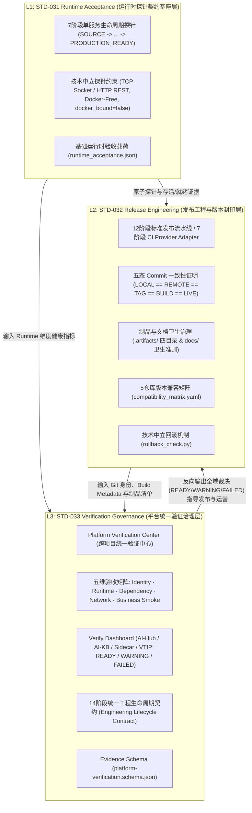
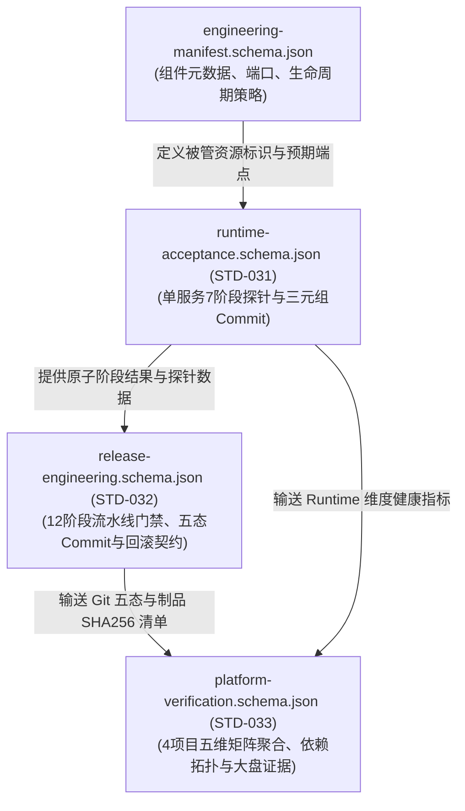

# STD-033: Platform Verification Governance (平台统一验证治理契约规范)

```text
STANDARD_ID=STD-033
VERSION=2.7.0
STATUS=ACTIVE
TASK_ID=AI-Platform-026-ENGINEERING-GOVERNANCE-FINALIZATION
ROLE=PLATFORM_ENGINEERING_GOVERNANCE_FINALIZATION
SCOPE=跨项目统一验证中心 (Platform Verification Center)、五维运行时验收矩阵 (Identity / Runtime / Dependency / Network Topology / Business Smoke)、统一工程生命周期契约 (Engineering Lifecycle Contract: PLAN -> ... -> FEEDBACK)、证据 Schema (platform-verification.schema.json)、验证大盘 (Verify Dashboard) 及 STD-031/STD-032/STD-033 协同治理关系
OWNER=AI Platform Governance Committee
LAST_UPDATED=2026-10-27
RELATED_STANDARDS=STD-001, STD-003, STD-005, STD-012, STD-014, STD-016, STD-019, STD-030, STD-031, STD-032
```

### 规范性关键词说明 (Normative Keywords)
本文档严格遵循 RFC 2119 规范性用词：
- **MUST / 必须**：绝对强制要求，违反即判定为治理不合规。
- **MUST NOT / 严禁**：绝对禁止项，任何受管系统不得违反。
- **SHOULD / 应当**：在有充分合理理由并经委员会批准时可以例外，常规必须遵守。
- **SHOULD NOT / 不宜**：不推荐的做法，存在治理或安全隐患。
- **MAY / 可以**：完全可选功能或扩展实现。

---

## 1. 规范背景与治理定位 (Background & Governance Positioning)

随着 AI 平台架构演进，系统已完整覆盖：
1. **控制中心 (AI-Engineering-Hub)**：模型统一调度、策略决策、运营大盘与平台验证中枢。
2. **知识库服务 (AI-KB)**：多模态知识沉淀、RAGFlow 检索引擎与向量感知。
3. **智能体边车 (vtip-ai-sidecar)**：业务智能体伴生、公文与日报润色、Fact Guard 事实核验。
4. **业务平台编目 (vtip-platform-catalog)**：业务编目协同、例会与工程治理知识图谱。

在前期阶段，平台先后确立了 **STD-031 运行时验收契约 (Runtime Acceptance)** 与 **STD-032 发布工程契约 (Release Engineering)**。然而，各仓库独立执行门禁虽然保证了单点交付质量，但缺少全域多维关联核验，存在“跨项目版本漂移”、“依赖拓扑隐蔽失联”、“网络环回与绑定边界盲区”等系统级风险。

`STD-033 Platform Verification Governance` 是 AI 平台工程治理的顶层终板规范，正式确立：
- **统一工程生命周期契约 (Engineering Lifecycle Contract)**：规范从 `PLAN` 到 `FEEDBACK` 的 14 阶段标准生命周期闭环。
- **平台统一验证中心 (Platform Verification Center)**：跨四大工程统一采集与判定五维运行时验收矩阵。
- **证据 Schema 契约与验证大盘**：以 `platform-verification.schema.json` 固化机器可读证据，并在 UI 提供三态 (`READY` / `WARNING` / `FAILED`) 实时可观测性。

---

## 2. 三大标准协同治理体系 (Tri-Standard Governance Stack)

平台工程治理确立 `STD-031`、`STD-032` 与 `STD-033` 三层递进式工程保障栈（Tri-Layer Engineering Assurance Stack）：



### 2.1 三大标准核心对比矩阵

| 治理维度 | STD-031 Runtime Acceptance | STD-032 Release Engineering | STD-033 Platform Verification Governance |
| :--- | :--- | :--- | :--- |
| **标准定位** | **探针基座层 (Probing Foundation)** | **交付流水线层 (Delivery Pipeline)** | **全域验证治理层 (Platform Governance Center)** |
| **关注核心** | 单服务与单组件是否技术中立可测、可存活、可就绪 | 代码如何经过门禁构建、打包、打 Tag、一致性发布与回滚 | 跨四大项目、外部依赖、网络拓扑与业务冒烟如何关联裁决 |
| **解决痛点** | 强绑定 Docker Daemon 导致跨环境验收脆弱 | 代码、远端、Tag、构建元数据与线上运行态的版本漂移 | 跨项目孤岛、证据不统一、依赖盲区与缺乏实时全局视角 |
| **生命周期范围** | 7 阶段运行时探针 (`SOURCE` 至 `PRODUCTION_READY`) | 12 阶段发布流水线 (`PLAN` 至 `TAG`) | 14 阶段统一工程生命周期 (`PLAN` 至 `FEEDBACK`) |
| **身份模型** | 三元组身份 (`SOURCE`, `BUILD`, `LIVE`) | 五态 Commit 一致性 (`LOCAL`, `REMOTE`, `TAG`, `BUILD`, `LIVE`) | 四大项目跨域五态一致性联合核验 + 兼容矩阵对齐 |
| **权威 Schema** | `runtime-acceptance.schema.json` | `release-engineering.schema.json` | `platform-verification.schema.json` |
| **权威输出** | `runtime_acceptance.json` | `release_report.json`、`build_info.json`、`artifact_manifest.json` | `platform_verification_report.json`、`runtime_matrix.json`、`verification_dashboard.json` |
| **裁决枚举** | `PASS` / `FAIL` | `PASS` / `FAIL` | `READY` / `WARNING` / `FAILED` |

### 2.2 递进演进法则
1. **STD-031 为基石**：STD-032 与 STD-033 严禁破坏 STD-031 技术中立探针约束 (`docker_bound = false`)。
2. **STD-032 为交付门禁**：为 STD-033 输送确定性 `LOCAL_HEAD`、`REMOTE_HEAD`、`TAG`、`BUILD_COMMIT` 与制品清单。
3. **STD-033 为平台汇聚**：将各项目离散产物收敛为单一事实源，建立平台治理闭环。

---

## 3. 统一工程生命周期契约 (Engineering Lifecycle Contract)

所有纳入 AI 平台治理体系的项目 **MUST** 遵循统一的 14 阶段工程生命周期契约：

```mermaid
flowchart LR
    PLAN["1. PLAN"] --> DESIGN["2. DESIGN"]
    DESIGN --> CODE["3. CODE"]
    CODE --> DEV_TEST["4. DEV_TEST"]
    DEV_TEST --> SECURITY_SCAN["5. SECURITY_SCAN"]
    SECURITY_SCAN --> BUILD["6. BUILD"]
    BUILD --> PACKAGE["7. PACKAGE"]
    PACKAGE --> PUBLISH["8. PUBLISH"]
    PUBLISH --> DEPLOY["9. DEPLOY"]
    DEPLOY --> RUNTIME_VERIFY["10. RUNTIME_VERIFY"]
    RUNTIME_VERIFY --> SMOKE_TEST["11. SMOKE_TEST"]
    SMOKE_TEST --> PRODUCTION_READY["12. PRODUCTION_READY"]
    PRODUCTION_READY --> OPERATE["13. OPERATE"]
    OPERATE --> FEEDBACK["14. FEEDBACK"]
    FEEDBACK -.->|"闭环反馈指导新一轮规划"| PLAN
```



### 3.1 14 阶段详细规范与准入准出条件

| 阶段标识 | 阶段名称 | 核心职责 | 准入条件 (Entry) | 准出判据 (Exit) | 责任主体 |
| :--- | :--- | :--- | :--- | :--- | :--- |
| `PLAN` | 规划需求 | 确定版本特性、范围与变更意图 | 需求明确、TASK_ID 确立 | 确定版本号（语义化 SemVer）、治理边界清晰 | 架构委员会 / 产品 |
| `DESIGN` | 方案设计 | 确定架构边界、接口与契约规范 | 规划批准 | 接口契约明确、相关标准引用齐备 | 架构委员会 / 研发 |
| `CODE` | 编码实现 | 源码开发、分支维护、工作区管理 | 设计评审通过 | 编码完成，`git clean` 无残留垃圾文件 | 研发人员 |
| `DEV_TEST` | 开发测试 | 单元测试、契约测试、集成测试、端到端测试 | 代码可执行 | 核心用例 100% PASS，覆盖率满足门禁 | 研发 / CI |
| `SECURITY_SCAN` | 安全扫描 | 零凭据扫描、依赖安全与代码审计 | 测试通过 | 零明文私钥/Token/API Key 入库 | 安全 / CI |
| `BUILD` | 构建元数据 | 固化构建时间、Git Commit、生成元数据 | 扫描通过 | 固化 `build_info.json` 与 `.build_commit` | 构建系统 / CI |
| `PACKAGE` | 制品打包 | 打包正式 ZIP/Wheel，计算 SHA256 摘要 | 构建完成 | 制品仅存 `.artifacts/packages/`，清单就绪 | 打包脚本 / CI |
| `PUBLISH` | 远端发布 | 代码推送到远端仓库，分支状态同步 | 打包完成 | `LOCAL_HEAD == REMOTE_HEAD` 远端同步 | Git 流水线 |
| `DEPLOY` | 服务部署 | 部署至目标环境、监听端口与存储挂载 | 发布成功 | TCP Socket / HTTP 端口存活可达 | 部署编排 / 运行态 |
| `RUNTIME_VERIFY` | 运行态核验 | 五态 Commit 校验、就绪与存活探针执行 | 端口可达 | `LOCAL == REMOTE == TAG == BUILD == LIVE` 校验 PASS | 运行时探针 (STD-031) |
| `SMOKE_TEST` | 业务冒烟 | 执行只读、非破坏性业务冒烟测试 | 运行态就绪 | 核心业务链路正常响应，零生产数据修改 | 业务探针 |
| `PRODUCTION_READY` | 生产就绪 | 验收总结判定、版本封印、Git Tag 固化 | 冒烟通过 | 生成 `runtime_acceptance.json`，打 Tag 并推送 | 生产验收委员会 |
| `OPERATE` | 生产运营 | 平台监控、指标采集、五维矩阵可观测 | 生产就绪 | 监控正常、服务稳定运行于 SLA 范围内 | 运营运维 |
| `FEEDBACK` | 治理反馈 | 收集真实运行质量、调用统计与演进建议 | 常态运营 | 沉淀治理评估、形成下一阶段任务输入 | 全域治理闭环 |

---

## 4. 五维运行时验收矩阵规范 (5-Dimension Runtime Acceptance Matrix)

平台统一验证中心执行时 **MUST** 全量覆盖以下 5 个正交维度，并输出至 `platform_verification_report.json`：

### 4.1 Dimension 1 — Identity Check (身份一致性核验)
- **校验字段**：`LOCAL_HEAD`、`REMOTE_HEAD`、`TAG`、`BUILD`、`LIVE`。
- **覆盖范围**：四大核心项目 (`AI-Hub`, `AI-KB`, `Sidecar`, `VTIP`)。
- **判定规则**：
  - 四大项目必须各自满足五态 Commit 一致 (`all_consistent = true`)。
  - 严禁本地存在未 push 的提交导致 `LOCAL_HEAD != REMOTE_HEAD`。
  - 严禁报告版本号超过实际运行版本号。

### 4.2 Dimension 2 — Runtime Check (运行态健康核验)
- **校验字段**：`service_health` (HTTP 状态码 200)、`process_status` (监听/进程存活)、`endpoint` (标准端口)、`startup` (元数据就绪)。
- **标准端口定义**：
  - `AI-Hub`：端口 `80` (标准) / `8080` (测试)。
  - `AI-KB`：端口 `18090` (`aikb-control-center`)。
  - `Sidecar`：端口 `8799` (`vtip-ai-sidecar`)。
  - `VTIP`：端口 `8787` (`vtip-platform-catalog`)。

### 4.3 Dimension 3 — Dependency Check (核心依赖感知核验)
- **校验对象**：
  - `Local CPA`：`18117`
  - `Cloud CPA`：`18317`
  - `AI-KB`：`18090`
  - `RAGFlow`：`18080`
  - `Ollama`：`11434`
  - `Database`：SQLite WAL 核心库 (`SELECT 1`)
- **非单点故障原则 (Non-SPOF)**：外部模型或通道不可用时，系统降级并标记依赖维度为 `WARNING`，**MUST NOT** 导致核心服务进程崩溃。

### 4.4 Dimension 4 — Network Topology Check (网络拓扑核验)
- **回环约束**：服务默认严格绑定宿主机回环 `127.0.0.1`，严禁未经鉴权的 `0.0.0.0` 全局开放。
- **跨边界访问**：容器化服务通过 `host.docker.internal` 访问宿主机，遵循 `STD-012` 边界规范。
- **服务发现**：支持 DNS 别名 (`localhost`, `host.docker.internal`, `cpa-local`) 与 Machine Manifest 自动发现。

### 4.5 Dimension 5 — Business Smoke Check (只读业务冒烟核验)
- **原则**：绝对只读、零数据修改、零副作用。
- **各组件冒烟用例**：
  - `AI-Hub`：`model/select` 只读模型路由规划验证，不改变模型权重或 Champion。
  - `AI-KB`：`readonly query` 知识库只读探测，严禁删除或重置 Formal Dataset。
  - `Sidecar`：`sample transform` 公文/日报润色只读验证与 Fact Guard 校验。
  - `VTIP`：`catalog query` 平台编目树只读校验，严禁 Confluence/Jira 远端写操作 (`REMOTE WRITE: 0`)。

---

## 5. Schema 引用与继承关系 (Schema Reference & Inheritance Architecture)

标准体系内的机器可读 JSON Schema 形成清晰的引用、扩展与组合关系：



### 5.1 Schema 职责边界与引用关系
1. **`engineering-manifest.schema.json`**：基础元数据模式，定义组件标识 (`component_id`)、生命周期策略 (`lifecycle_policy`)、标准监听端口 (`port`) 与健康端点 (`health_endpoint`)。
2. **`runtime-acceptance.schema.json`**：技术中立单组件探针输出模式，校验单服务阶段执行与探针明细。
3. **`release-engineering.schema.json`**：单仓库发布门禁输出模式，校验 6 大门禁、Git 五态一致性与回滚契约。
4. **`platform-verification.schema.json`**：全平台聚合输出模式，汇总四大项目组件、五维矩阵明细与总体状态。

---

## 6. 四项目模板统一规范 (Four-Project Template Unification)

AI 平台的四大核心项目（`AI-Engineering-Hub`、`AI-KB`、`vtip-ai-sidecar`、`vtip-platform-catalog`）**MUST** 统一在 `scripts/release/` 下具备以下 5 个标准化工程脚本：

```text
scripts/release/
  ├── build_metadata.py      # 构建元数据生成器 (生成 build_info.json 与 .build_commit)
  ├── runtime_acceptance.py  # 技术中立运行时验收与五态 Commit 核验器
  ├── release_pipeline.py    # 12阶段发布流水线与自动化门禁执行器
  ├── artifact_manifest.py   # .artifacts/ 目录治理与 SHA256 清单生成器
  └── rollback_check.py      # 技术中立回滚可行性核验器
```

### 6.1 统一输出规范 (Unified Artifact Outputs)
每次流水线与验收执行必须在 `.artifacts/` 目录中统一生成以下 3 个标准化文件：
1. **`runtime_acceptance.json`**：保存在 `.artifacts/acceptance/runtime_acceptance.json`，记录运行时验收与探针结果。
2. **`release_report.json`**：保存在 `.artifacts/reports/release_report.json`（同时兼容输出 `release_pipeline_report.json`），记录 12 阶段流水线与门禁判定。
3. **`artifact_manifest.json`**：保存在 `.artifacts/reports/artifact_manifest.json`，记录所有生成制品的 SHA256 摘要与文件清单。

---

## 7. Git 发布治理铁律 (Git Release Governance Invariants)

生产发布必须严格遵循以下 6 项铁律：
1. **工作区干净 (Commit Clean)**：`git status --porcelain` 必须为空，严禁带有未跟踪或修改的代码进行发布。
2. **推送远端 (Push Remote)**：本地发布分支必须推送到远端仓库，确保 `LOCAL_HEAD == REMOTE_HEAD`。
3. **创建标签 (Create Tag)**：根据语义化版本规范创建版本标签 `v<MAJOR>.<MINOR>.<PATCH>`。
4. **验证标签 (Verify Tag Commit)**：标签指向的 Commit 必须严格等于本地与远端 HEAD (`TAG_COMMIT == LOCAL_HEAD`)。
5. **构建一致 (Build Commit Invariant)**：`build_info.json` 固化的 `BUILD_COMMIT` 必须与 `LOCAL_HEAD` 严格一致。
6. **线上一致 (Live Commit Invariant)**：线上实际运行进程返回的 `LIVE_COMMIT` 必须与 `LOCAL_HEAD` 严格一致。

> [!CAUTION]
> **绝对禁止两类行为**：
> 1. **严禁本地提交未 Push**：禁止在 `LOCAL_HEAD != REMOTE_HEAD` 的状态下出具通过的发布报告。
> 2. **严禁版本号虚标超前**：严禁报告中声明的版本号超过实际代码与运行环境的版本号。

---

## 8. Artifact 与文档治理规范 (Artifact & Documentation Hygiene)

### 8.1 `.artifacts/` 统一四目录治理
所有临时产物、测试输出、发布包与截图 **MUST** 严格收敛至项目根目录 `.artifacts/`：

```text
.artifacts/
  ├── acceptance/    # 验收过程数据与阶段验收报告
  ├── packages/      # 正式发布包与 Acceptance-*.zip (正式ZIP唯一合法存储目录)
  ├── screenshots/   # UI 自动化测试截图与 Playwright 录屏
  └── reports/       # release_report.json、artifact_manifest.json 与全域报告
```

### 8.2 `docs/` 绝对卫生准则
- **严禁测试产物污染（放行正式架构图）**：除 `docs/01-架构设计/` 与 `docs/**/assets/` 下受版本追踪的正式架构图与正式项目图片（`.png`, `.jpg`, `.jpeg`, `.svg`，见 `STD-019` 第 1.1 节）外，`docs/` 目录内 **MUST NOT** 保存任何 `.zip` 压缩包、测试截图/录屏（`.png`, `.jpg`, `.webp`, `.webm`, `.mp4`）或临时日志（`.log`, `.tmp`）。
- **职责清晰**：
  - `Standards` 仓库：全平台架构与工程治理规范的唯一事实源。
  - 各项目 `docs/`：仅保存该项目的使用说明、部署指南与架构设计文档。
  - `Acceptance` 目录：验收报告与证据材料。
  - **严禁跨库复制规范**：禁止将 Standards 规范全文复制到各业务项目 docs 形成多副本版本分叉。

---

## 9. 演进与迁移指南 (Migration Guide)

### 9.1 从草案到正式 STD-033 的迁移步骤
1. **标准引入**：在项目依赖中声明 `AI-Engineering-Standards >= 2.4.0`。
2. **脚本对齐**：检查并确保 `scripts/release/` 下具备 5 个标准化脚本（补齐 `rollback_check.py`）。
3. **产物对齐**：确保流水线输出包含 `runtime_acceptance.json`、`release_report.json` 与 `artifact_manifest.json`。
4. **目录治理**：创建 `.artifacts/reports/` 并清理 `docs/` 中非法存放的二进制或日志文件。
5. **验证接入**：运行 `python scripts/release/release_pipeline.py` 与 `python scripts/release/verification_center.py` 验证全绿通过。

---

## 10. 权威 Manifest 示例 (Example Manifests)

### 10.1 `manifest.json` 示例 (符合 STD-033 规范)

```json
{
  "task_id": "AI-Platform-026-ENGINEERING-GOVERNANCE-FINALIZATION",
  "version": "2.4.0",
  "standard": "STD-033",
  "governance_stack": ["STD-031", "STD-032", "STD-033"],
  "lifecycle_contract": "14-STAGE-ENGINEERING-LIFECYCLE",
  "projects": {
    "AI-Engineering-Standards": {
      "version": "2.4.0",
      "status": "PASS",
      "schema_validated": true
    },
    "AI-Engineering-Hub": {
      "version": "v0.20.3",
      "status": "READY",
      "commit": "f8326fd",
      "five_way_consistent": true
    },
    "AI-KB": {
      "version": "v0.9.0",
      "status": "READY",
      "commit": "cddd081",
      "five_way_consistent": true
    },
    "vtip-ai-sidecar": {
      "version": "v0.14.2",
      "status": "READY",
      "commit": "3393806",
      "five_way_consistent": true
    },
    "vtip-platform-catalog": {
      "version": "v2.6.7",
      "status": "READY",
      "commit": "d44c06a",
      "five_way_consistent": true
    }
  },
  "overall_status": "READY"
}
```

### 10.2 `engineering-manifest.yaml` 补充字段示例

```yaml
engineering_governance:
  standard: "STD-033"
  lifecycle_contract: "PLAN -> DESIGN -> CODE -> DEV_TEST -> SECURITY_SCAN -> BUILD -> PACKAGE -> PUBLISH -> DEPLOY -> RUNTIME_VERIFY -> SMOKE_TEST -> PRODUCTION_READY -> OPERATE -> FEEDBACK"
  release_scripts:
    - "scripts/release/build_metadata.py"
    - "scripts/release/runtime_acceptance.py"
    - "scripts/release/release_pipeline.py"
    - "scripts/release/artifact_manifest.py"
    - "scripts/release/rollback_check.py"
  artifacts_layout:
    - ".artifacts/acceptance"
    - ".artifacts/packages"
    - ".artifacts/screenshots"
    - ".artifacts/reports"
```


---

## 10. 部署证据真实性、回滚可靠性与验收事实一致性契约 (Deployment Truth, Rollback & Acceptance Consistency)

### 10.1 真实部署与运行态身份一致性 (Authentic Deployment & Identity Match)
1. **Source Commit 与 Live Commit 独立取证**：
   - `SOURCE_COMMIT`：从工作区 Git HEAD 或构建元数据中取证。
   - `LIVE_COMMIT`：从正在运行的服务进程或容器通过 HTTP 探针（`/health`、`/api/runtime/identity`）实时获取。
   - 两个标识 **MUST** 独立取证，严禁在未部署时将目标 `SOURCE_COMMIT` 直接覆盖为 `LIVE_COMMIT`。
2. **未部署时严禁冒充运行态**：
   - 当任务处于开发、修复或未获生产部署授权状态（如 `PRODUCTION_DEPLOYMENT_AUTHORIZED=false`）时，运行态依然为当前线上服务（如 `v0.21.5` / `9e175c6`）。
   - `manifest.json`、`verification_summary.json` 及验收报告中，`LIVE_COMMIT` **MUST** 忠实记录当前线上真实 Commit，并标记 `source_build_live_match = false`，`deploy_status = "BLOCK"`，并另设 `reason = "PROTECTED_AWAITING_APPROVAL"`。
   - **严禁**在未执行真实部署时，在报告中宣称目标版本为线上运行态。

### 10.2 本地测试与远端 CI 结论独立记录 (Local Test vs Remote CI Separation)
1. 本地执行的测试（如 pytest contract / integration / runtime / security）结论记录为 `LOCAL_TEST_STATUS`。
2. GitHub Actions 远端真实流水线结论记录为 `REMOTE_CI_STATUS`（附带 `REMOTE_CI_RUN_URL`）。
3. 两者 **MUST** 分离记录，严禁将本地测试通过冒充远端 CI 通过；若 GitHub Actions 最新结论为 `failure`，验收摘要中 `REMOTE_CI_STATUS` **MUST** 记录为 `FAIL`。

### 10.3 故障注入与回滚可靠性验证 (Fault-Injection & Rollback Resilience)
1. 部署执行器 **MUST** 在完全隔离的测试环境（非生产端口 80）下通过故障注入测试验证回滚能力：
   - 验证备份目录与正式数据物理隔离；
   - 验证旧镜像固定至完整不可变 Image ID 或 Digest；
   - 验证回滚操作不会因容器命名冲突而崩溃；
   - 验证重复触发回滚具有幂等性；
   - 验证回滚后原有编排配置（如 Docker Compose）可再次无缝接管服务；
   - 验证回滚失败或成功时均产生完整审计日志。
2. **严禁在生产端口 80 上执行破坏性演练**：生产端口 80 仅在获得正式发布授权且所有前置门禁全绿后，方可执行受控部署。

### 10.4 证据事实矛盾判定法则 (Evidence Contradiction Auto-Fail)
1. 任一交付物或验收包中，若发现以下事实矛盾：
   - `manifest.json` 中声明的 `live_commit` 与 `runtime_identity.json` 真实返回不一致；
   - 报告中宣称 `REMOTE_CI_STATUS=PASS`，但远端 GitHub Actions 实际为 `failure`；
   - 未执行生产部署却声明 `DEPLOY=PASS`；
   - 将 Dry Run PASS 冒充正式发布 PASS；
2. 自动化交付契约门禁 **MUST** 直接判定该验收为 `FAIL`，并在报告中标记不可信任原因。


### 10.5 机器证据关联
验收打包前 MUST 关联源 Commit 的远端 CI 原始结论、原始本地命令/退出码/日志、实时运行身份、部署执行审计及流水线逐阶段结果。摘要不得用本地测试填充远端 CI，不得从 source 推导 live 或 build。无法获取构建身份必须报告 NOT_VERIFIABLE。跨文件身份或阶段结论矛盾 MUST 直接 FAIL；如实记录未部署 BLOCK 的开发验收包可以完整打包，但不能代表生产发布通过。最终 Tag 必须向远端取证，不得用本地候选 Tag 替代。

### STD-032 审批配置协同 (2.6.0)

生产审批 MUST 使用 STD-032 §4 的显式互斥配置。审计 MUST 区分候选、加密签名验证和独立人工信任边界；schema 合法、workflow 成功、裸布尔值或 Agent 自签不得产生人工 PASS。未知/不可核验边界 MUST BLOCK，禁止自动降级。编码 Agent MUST NOT 注册自有密钥为审批身份、触发签署、输入 PIN 或保存可复用审批凭证。所有证据来源及未执行阶段 MUST 如实记录。
